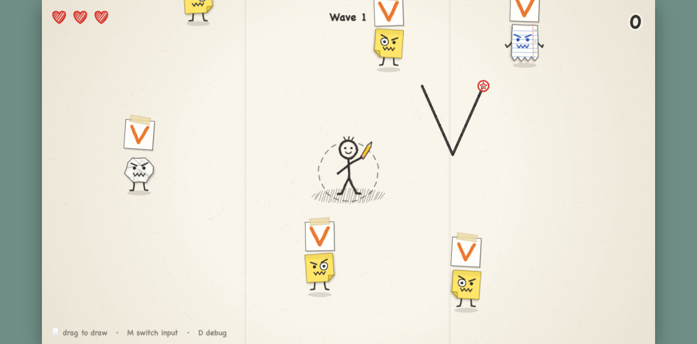

# SPELLCAM

You are a stick figure on a sheet of paper, and the paper monsters are closing in. Draw shapes in the air with your fingertip to tear them up before they reach you.

Your webcam tracks your hand in the browser (MediaPipe). Pinch your thumb and index finger to start drawing, and release to cast. Each monster carries a queue of symbols on a scrap of paper taped above it. Drawing a symbol strips it from **every** monster whose next symbol matches, so one spell can hit several at once.

Built at HackPrinceton Fall '26 (Entertainment & Media track). The design doc is [`init_plan.md`](init_plan.md).



## Run it

```bash
npm install        # also copies the MediaPipe wasm into public/ and fetches the hand model if missing
npm run dev        # http://localhost:5173
```

Click **Enable camera & sound** to play with your hand, or **Play with mouse only**. Camera access works on `localhost` without HTTPS. Adding `?mouse` to the URL skips the start screen in mouse mode.

Everything runs in the browser. There is no backend. The hand model (`public/models/hand_landmarker.task`) is committed, and the wasm runtime is copied from `node_modules` on install, so the game never needs a CDN or venue Wi‑Fi. If the local files are missing, it falls back to the CDN automatically.

## How to play

- **Hand:** pinch thumb + index to start inking, move to draw, release to cast. The cursor follows the base knuckle of your index finger, so it stays put while you pinch and release.
- **Mouse:** drag to draw, release to cast.
- **Start / restart:** pinch and hold (or hold the mouse button, or press Space).
- **Symbols:**

  | Name | Symbol |
  |---|---|
  | dash | — |
  | pillar | \| |
  | vee | V |
  | peak | Λ |
  | ring | ◯ |
  | bolt | zigzag (M or W) |

  Any drawing direction works.
- **Waves:** wave 1 uses three symbols, wave 2 adds Λ and ◯, and wave 3 adds the zigzag and multi-symbol monsters.
- **Score:** +100 per symbol removed, +250 per kill. One cast hitting 2 monsters scores ×2, and 3 or more scores ×3. A streak multiplier (+0.5× every 5 hitting casts, up to ×3) resets when you take damage. You get 3 hearts.

### Hotkeys

| Key | Action |
|---|---|
| `M` | switch hand ↔ mouse input (mouse is also the automatic fallback) |
| `D` | debug overlay: camera preview with hand skeleton and drawing box, pinch ratio, FPS, last recognition + score, resampled stroke |
| `K` | calibrate the drawing area: sweep your pinch over a comfortable area for 4 s |
| `C` | next camera (laptop ↔ external webcam) |
| `F` | toggle mirroring |
| `G` | **demo run**: seeded RNG, slightly slower monsters, and an opening that sets up a multi-hit |
| `T` | template recorder on/off (`1`–`6` pick the symbol, `E` exports `templates.json`) |
| `N` | mute |
| `Esc` | back to the title screen |

## Recording real templates (do this before the demo)

The recognizer ships with synthetic templates for every symbol in both directions, so it works out of the box. Real strokes from real hands make it better:

1. Press `M` for hand mode, then `T` to start recording.
2. Press `1`–`6` to choose a symbol (dash, pillar, vee, peak, ring, bolt), then draw it 5+ times, in both directions. Strokes are saved to `localStorage` immediately and used right away.
3. Get 2–3 other people to add a few each.
4. Press `E` to download `templates.json`, replace `src/input/templates.json` with it, and commit.

Lines (dash and pillar) are classified by angle before template matching, so recording them is optional.

## Tests

```bash
npm test           # vitest: recognizer accuracy, One Euro filter, pinch hysteresis/debounce, stroke detector
npm run typecheck
npm run build      # static site in dist/
```

The recognizer tests draw 12 jittered strokes per base shape and direction (random size, position, rotation ±10°, vertex and point noise). They require ≥ 90% accuracy per symbol, zero confusions between `—`/`|` and `V`/`Λ`, and that ≥ 70% of random scribbles fizzle.

## Deploy

`npm run build` produces a static `dist/`. Host it on GitHub Pages, Vercel or Netlify. Camera access needs **HTTPS** when deployed, which all three provide. For the live demo, run from `localhost` with the local model file.

## Code map

```
src/
  main.ts                 boot: start screen (camera + audio unlock) → Phaser; global hotkeys
  config.ts               every tunable: pinch thresholds, One Euro, drawing box, recognizer, waves, scoring
  state.ts                shared app state (mode, tracker status, last recognition…)
  input/
    events.ts             the input → game event bus (InputEvent)
    mouseAdapter.ts       mouse/touch drag → same events
    camera.ts             getUserMedia, camera switching, mirroring
    handTracker.ts        MediaPipe loop (GPU → CPU fallback), pinch → cursor → strokes, calibration
    oneEuro.ts            One Euro filter
    strokeDetector.ts     pinch hysteresis + debounce, stroke start/points/end, end trimming
    recognizer.ts         orientation-sensitive $1 + straight-line special case
    shapes.ts             ideal symbol shapes + jittered synthetic templates
    castPipeline.ts       strokeEnd → recognize → symbol / fizzle; template recorder
    templates.json        recorded human templates (bundled)
    debugOverlay.ts       D overlay
  game/
    scenes/               Boot (procedural art), Title, Arena, GameOver
    entities/             Player, Monster, SymbolBubble
    systems/              Spawner, Casting (trail + spells), Hud, Fx, HoldToStart
    sfx.ts                procedural Web Audio sound effects
```

## Decisions and known gaps

- **Not yet verified on a real hand.** The build machine had no webcam in the loop. The MediaPipe model loads locally on the GPU delegate in ~150 ms, and the whole game was play-tested with simulated mouse strokes. But pinch thresholds (`INPUT.pinchOn` 0.28 / `pinchOff` 0.5, a 3D veto at `pinch3dMax` 0.5, plus a 180 ms release grace period), One Euro parameters (`minCutoff` 1.0, `beta` 0.01) and the default drawing box all need tuning on a real webcam. Use `D` to see the live pinch ratio.
- **The cursor follows the index-finger base knuckle** (`INPUT.cursorAnchor: "knuckle"`), which does not move when the fingers pinch or open. Set it to `"pinch"` for the thumb–index midpoint instead. A release has to last 180 ms (300 ms if the hand is lost) before a stroke ends, and the stroke is cut back to where the release began. The first and last 3 points of each hand stroke are also trimmed.
- **Symbols a monster currently needs are matched first, with a lower bar** (score ≥ 0.55 and within 0.08 of the best match overall, against 0.76 otherwise). A slanted line counts as a dash or pillar when only one of the two is needed.
- **The recognizer is \$1 without rotation invariance.** It searches only ±25° of rotation, so `|` ≠ `—` and `V` ≠ `Λ`. Circles have templates at 8 start angles × 2 directions. Zigzag accepts 3- and 4-segment zigzags (M, W, N-like) in both directions.
- **Art and sound are procedural** (canvas drawing and Web Audio oscillators). Everything is paper and pencil: a plain folded sheet for the arena, wobbly double-stroked pencil lines, cut-out monsters (a crumpled ball, a torn notebook page, a sticky note), marker symbols and handwriting fonts that ship with macOS. Colours live in `src/game/palette.ts` and the drawings in `src/game/scenes/Boot.ts`. There are no third-party assets. Textures are drawn once and registered as images, so they survive a WebGL context loss.
- **The webcam feed sits faintly behind the whole arena** (greyscale, under a mostly opaque sheet of paper, so it reads as a faint pencil sketch), with a full preview in the debug overlay.
- **All tunables are in a single `src/config.ts`**, instead of separate input and game config files.
- **Out of scope for now:** mana, pose modifiers, combos, PvP, learning modes, and the leaderboard (see `init_plan.md` §9).
